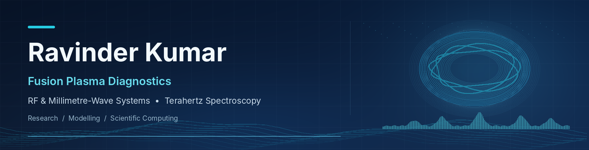

  

<h1 align="center">Hello, I'm Ravinder Kumar 👋</h1>

  <strong>Scientist at ITER-India, Institute for Plasma Research (IPR)</strong> 
  Fusion Plasma Diagnostics · RF & Millimetre-Wave Systems · Terahertz Spectroscopy

  
  
  
  
  

## About me

I am a scientist with more than 15 years of experience in RF, microwave, millimetre-wave and terahertz technologies. My work involves the design, development, testing and integration of high-frequency systems for fusion plasma diagnostics, particularly Electron Cyclotron Emission (ECE) diagnostics for ITER.

I enjoy bringing together practical engineering, experimental measurements, physics-based modelling and scientific computing to understand and improve measurement systems.

## Research and technical interests

| Area | Focus |
|---|---|
| **Fusion plasma diagnostics** | ECE measurement systems and diagnostic performance |
| **RF & millimetre-wave technology** | Receivers, high-frequency components and measurement methods |
| **Terahertz spectroscopy** | Broadband Fourier Transform Spectroscopy (FTS), calibration and data analysis |
| **Modelling & simulation** | Synthetic diagnostics, plasma-related modelling and instrument response |
| **Scientific computing** | Python, numerical analysis, signal processing and visualisation |

## What I'm exploring

- Modelling and analysis of broadband ECE measurements
- Computational workflows for scientific and engineering problems
- Clear, reproducible Python examples for RF and spectroscopy concepts
- Data visualisation and reliable interpretation of measurement results

## Connect

I'm interested in exchanging ideas with researchers and engineers working on fusion diagnostics, high-frequency systems and scientific computing.

**GitHub:** [@ravinderkumar24](https://github.com/ravinderkumar24)

---

This is a personal profile. Public examples and opinions here are my own and do not represent official positions of ITER, ITER-India or IPR.
